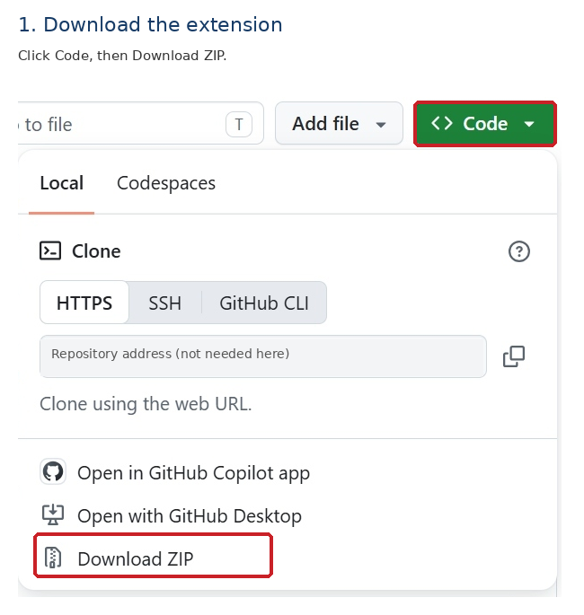
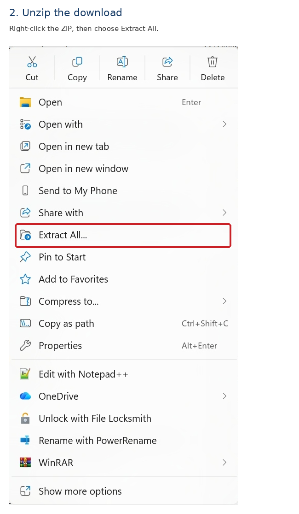
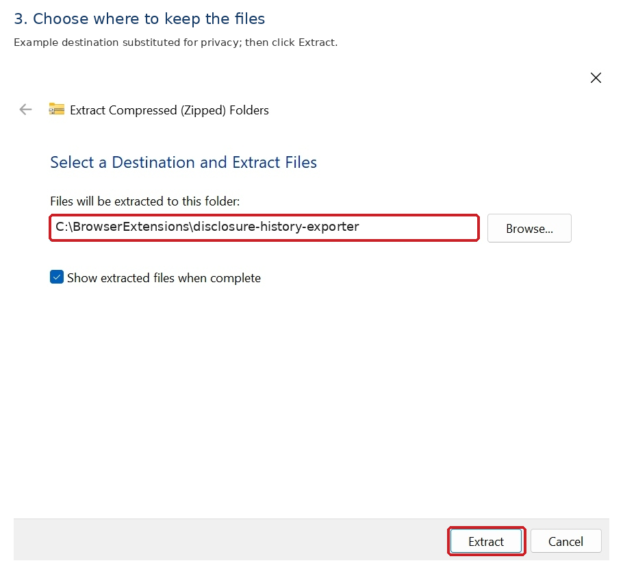
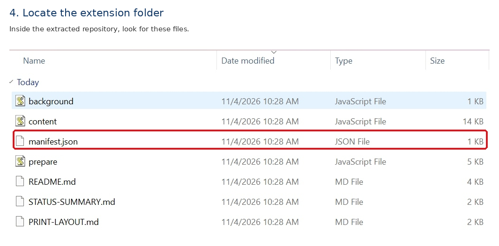
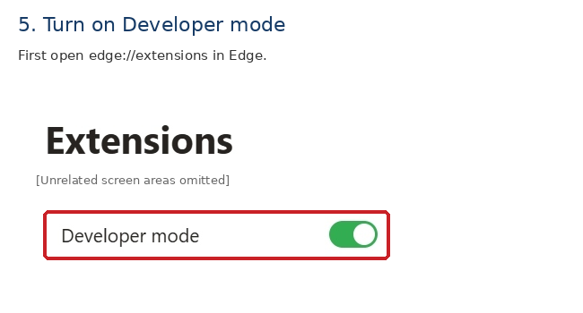
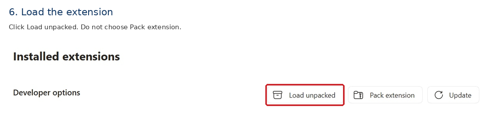
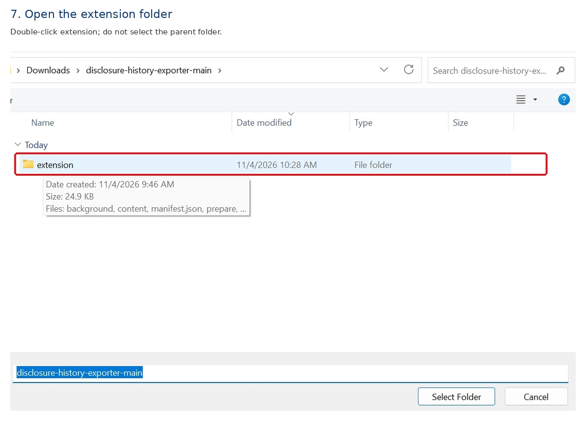
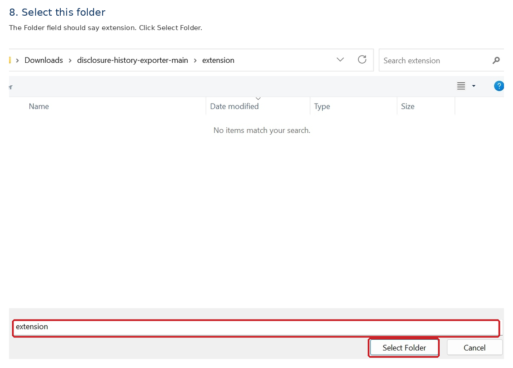
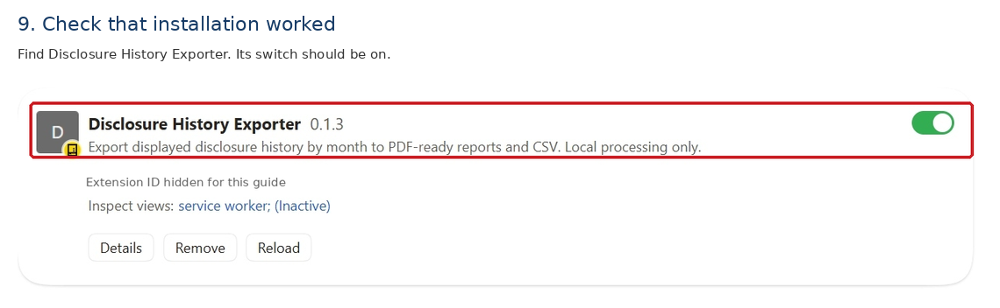
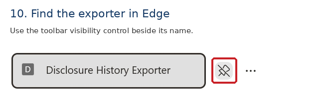

# Start here: install Disclosure History Exporter in Edge

A plain-language guide for Windows 11 and Microsoft Edge. This is a separate beginner guide; the existing technical README is not replaced.

You need the extension download and access to the signed-in disclosure website. No Dev Console is needed. Install only the copy approved by your IT team. Pictures are cropped and annotated real screenshots; personal details have been removed. The extraction destination is an explicitly edited example. Screen layout and version labels may differ.

## 1. Download the extension

Open https://github.com/mjpcomp/disclosure-history-exporter in Microsoft Edge. Click the green Code button, then Download ZIP. Save the ZIP on your computer. You do not need GitHub Desktop or the clone address.

## 2. Unzip the download

Open File Explorer and find the ZIP, usually in Downloads. Right-click the ZIP and choose Extract All. Do not install from inside the ZIP.

## 3. Choose a permanent home

Choose a folder you will keep. The illustrated destination C:\BrowserExtensions\disclosure-history-exporter is an example substituted for privacy; IT may recommend another location. Click Extract. Do not delete or move the extracted files after installation.

## 4. Find the correct folder

Open the extracted repository folder, then extension. You should see manifest.json, background, content, and prepare. Windows may hide the .js endings. Do not open or edit these files.

## 5. Open Edge extension settings

In Edge's address bar, type edge://extensions and press Enter. Turn on Developer mode. Its position may differ with window size. If your organization blocks it, contact IT; do not bypass company policies. You do not need to enable Allow extensions from other stores for this installation.

## 6. Choose Load unpacked

Click Load unpacked, not Pack extension. A folder-selection window opens.

## 7. Open the extension folder in the picker

Browse to the extracted files. Open the repository folder, then double-click extension. Do not select the parent repository folder.

## 8. Select the folder, not a file

The Folder field should say extension. The file area may appear empty or say No items match your search: this is a folder picker. Click Select Folder. If Edge reports a missing manifest, choose the extracted folder containing manifest.json.

## 9. Confirm installation

The Extensions page should show Disclosure History Exporter with its switch on. The version in the example may differ from the current release. Installation is complete; switch to the signed-in disclosure website.

## 10. Find the toolbar control

Click Edge's puzzle-piece Extensions button and find Disclosure History Exporter. Use its pin/toolbar visibility control if you want its icon to remain on the toolbar. Run it on the disclosure website, not on edge://extensions; the message saying extensions are not allowed on that settings page is expected there.

## Make a monthly report

1. Sign into the disclosure website and open Disclosure History.
2. Clear search and all filters so you do not limit the report accidentally.
3. Click the exporter icon. If the page may be stale, choose Refresh history and confirm. After reloading, click the icon again.
4. Choose Set 100 rows & open exporter and wait for the month/year panel.
5. Select month/year and Generate report. Confirm the reminder. Allow pop-ups for this website if Edge blocks the report window.
6. Leave the source page alone while scanning. Keep it open until you finish saving.
7. In the report window, choose Save / Print PDF, then Save as PDF or your approved PDF printer. Use Landscape and check the preview. Download monthly CSV for spreadsheet detail rows. Download undated CSV to review exclusions.

The summary counts each included record once using its displayed status when collected. Undated records are excluded from monthly totals and flagged separately. Repeated sends are separate records, not unique buyers. Store reports securely because they contain buyer information.

## If something goes wrong

- Manifest missing/unreadable: choose the extracted extension folder containing manifest.json, not the ZIP or parent folder.
- Nothing happens on settings: open the signed-in disclosure website and click the exporter there.
- Report window blocked: allow pop-ups for the disclosure website and retry.
- History count changed: refresh history, reopen the exporter, prepare 100 rows, and retry. Do not accept an incomplete report.
- Developer mode unavailable: ask IT; do not bypass organization restrictions.
- No matching records: check month/year and filters and review undated exclusions.

## Updating an existing installation

Unpacked extensions do not automatically update from GitHub. Ask IT to replace the files in the same permanent installation folder. Open edge://extensions and click Reload on Disclosure History Exporter, then refresh the disclosure webpage. You normally do not need to remove and reinstall. Keep the installed folder in place.
